# Autonomous Driving Perception Stack (AIML-04)

Author: Darshan Kumar GP (intern ID GPNEX-INT-2026-0766), AI / Machine Learning internship, October to November 2026.

A vision pipeline for driving footage: object detection and tracking, lane detection (classical OpenCV compared with a segmentation model), monocular depth for approximate distances, ONNX and TensorRT optimisation with benchmarks, and a ROS2 demo that streams recorded video through the pipeline inside Docker.

**Honest scope, read this first.** CARLA was not run: the laptop GPU has 4 GB and CARLA asks for at least 6 GB. The ROS2 demo therefore processes recorded dashcam footage, and the warning it shows is a rule on image position, not control of a vehicle. Distances are approximate. See Limits below.

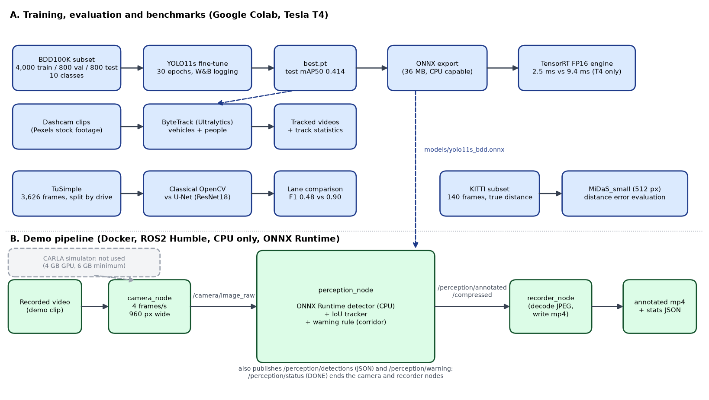

## What the brief asked for, and what was done

| Brief item | Status | Where |
|---|---|---|
| 1. BDD100K or KITTI, explore labels and class balance | Done: BDD100K subset (4,000 train / 800 val / 800 test), class balance and weather / time-of-day plots | docs/DATA.md, assets/class_balance_train.png, assets/conditions.png |
| 2. Fine-tune YOLO, track with ByteTrack or DeepSORT | Done: YOLO11s fine-tune and ByteTrack on 5 dashcam clips. No ground-truth track ids exist, so there is no ID-switch score | notebooks/02_train_yolo.ipynb, notebooks/03_tracking.ipynb |
| 3. Classical lane detection (OpenCV) compared with a segmentation model | Done: classical detector vs U-Net (ResNet18), scored on TuSimple with a held-out drive | src/lane_classical.py, notebooks/04_lane_seg.ipynb |
| 4. Monocular depth (MiDaS) for distance | Done: MiDaS_small, distance error measured on KITTI. Conversion does not transfer to unknown cameras | notebooks/05_depth.ipynb |
| 5. CARLA, virtual camera, ROS2 nodes | Partly: ROS2 Humble nodes in Docker, fed with recorded video. CARLA NOT run | ros2/, docker-compose.yml |
| 6. ONNX export and TensorRT, latency and FPS before and after | Done for the detector (TensorRT built on a Tesla T4) | notebooks/07_export_benchmark.ipynb, docs/benchmark_yolo.json |
| 7. Weights & Biases logging and demo video | W&B logs for the detector and the lane model. The demo video is in the submission Drive folder (01_demo_video.mp4) | See Weights & Biases below |

## Results at a glance

| Area | Result | Detail |
|---|---|---|
| Detector (YOLO11s, 800 held-out test images) | mAP50 0.414, mAP50-95 0.220, precision 0.703, recall 0.381 | car 0.721 is best. bike 0.250, rider 0.286 and motor 0.287 are weak. The train class has a single test box, so its score is meaningless |
| Detector by condition (test mAP50) | day 0.476, night 0.384, dawn/dusk 0.438 | rain 0.386 (51 images), snow 0.460 (63 images). Groups are small and weather and lighting overlap |
| Tracking (ByteTrack, 5 clips) | no ID-switch metric available | 37 to 50 percent of tracks lasted fewer than 5 frames in the first run. Tuning the thresholds did not lengthen tracks |
| Lanes (TuSimple, held-out drive, 410 frames, 4 px tolerance) | U-Net F1 0.898 (precision 0.960, recall 0.843). Classical OpenCV F1 0.480 (precision 0.968, recall 0.319) | Inside the region the classical method covers: classical F1 0.846, U-Net 0.982 |
| Distance (MiDaS_small, 512 px, 611 KITTI objects) | median error 24.4 percent, 45.0 percent within 25 percent. Near/far order correct 95.4 percent | error grows with distance: 16.0 percent at 3 to 15 m, 46.8 percent at 50 to 80 m. A flat-road formula with KITTI calibration was more accurate (13.0 percent) |
| Optimisation (T4, batch 1, 640 px) | TensorRT FP16 2.50 ms per image (181 FPS incl. pre/post) vs PyTorch FP32 9.42 ms (74.9 FPS) | 3.8x faster model time. mAP50 0.4114 vs 0.4136. ONNX Runtime GPU 8.47 ms |
| ROS2 demo (Docker, laptop CPU) | In-lane traffic clip: 86 of 86 frames processed, CAUTION in 64 frames, BRAKE never reached | callback median 223 to 432 ms across runs at 4 frames/s input. Above 250 ms the demo runs slower than real time |
| Tests | 24 pytest tests pass (23 pass and 1 skips if the model file is absent) | tests/ |

## Limits

- No CARLA. The ROS2 demo streams recorded video and shows a warning rule, not vehicle control. Warning thresholds are uncalibrated guesses.
- The container uses a simple IoU tracker and ONNX Runtime on the CPU (no PyTorch, because Docker is capped at 4 GB). ByteTrack results come from the notebooks.
- Detector trained on a 4,000-image subset for 30 epochs, so scores are lower than full-dataset results. Night is clearly worse than day. Rare classes (train, motor, rider) have too few boxes for reliable scores.
- Distances from MiDaS are approximate and were validated only on KITTI. Distances on the demo clips (unknown cameras) are not validated.
- Lane results come from one highway dataset and test frames from a single drive.
- Speed numbers: GPU numbers are for a Tesla T4 on Colab. The TensorRT engine only works on a T4. CPU numbers vary between runs and I do not know why.
- Research and educational prototype. Not suitable for driving decisions.

More detail: docs/TEST_RESULTS.md, docs/MODEL_CARD.md, docs/ARCHITECTURE.md and docs/DATA.md.

## Quick start

Tested from a fresh clone on Windows 11 with PowerShell, Python 3.13 and Docker Desktop.

```powershell
git clone https://github.com/DarshanKumarGP/autonomous-driving-perception
cd autonomous-driving-perception
python -m venv venv
venv\Scripts\activate
pip install -r requirements-dev.txt
python -m pytest -q
```

### Model files

The models are tracked with DVC (models.dvc), but the DVC store is on the author's laptop, so `dvc pull` will not work for you. Copy these files from the submission Drive folder (07_models) into a folder called `models` in the repository:

- yolo11s_bdd.onnx (detector, needed for the ROS2 demo)
- yolo11s_bdd_best.pt (detector weights)
- lane_unet_best.pt (lane model)
- yolo11s_bdd_fp16_t4.engine (TensorRT engine, only works on a Tesla T4, optional)

Without the models folder the tests still run (23 pass, 1 skipped).

### ROS2 demo (Docker)

The raw stock clips are not in this repository. Use any dashcam video of your own:

```powershell
mkdir data\videos
python scripts\make_demo_clip.py --src C:\path\to\your_video.mp4 --dst data\videos\demo720.mp4 --seconds 20
docker compose up --abort-on-container-exit
docker compose down
```

Results appear in `outputs\ros2` (demo_annotated.mp4, demo_stats.json, demo_frames.jsonl). Settings can be changed with environment variables VIDEO, RUN_NAME and PUBLISH_HZ, for example `$env:PUBLISH_HZ="3"`. The container is limited to 3 GB of memory and has a health check.

### Notebooks

The notebooks in `notebooks/` ran on Google Colab with a Google Drive folder `MyDrive/adp_project`. Colab Secrets named KAGGLE_API_TOKEN, HF_TOKEN and WANDB_API_KEY were used. No keys are stored in the notebooks. The numbering skips 06 because the ROS2 phase is not a notebook.

## Repository layout
assets/ plots, screenshots and the architecture diagram
docs/ DATA.md, ARCHITECTURE.md, FEASIBILITY.md and result files (json, csv)
notebooks/ Colab notebooks 01 to 05 and 07 (outputs cleared)
ros2/ Dockerfile, ROS2 nodes and launch file
scripts/ demo clip cutter, diagram script, requirements writer
src/ onnx_yolo.py, iou_tracker.py, warning_logic.py, lane_classical.py
tests/ pytest tests
models.dvc DVC pointer to the model files (files are not in git)
docker-compose.yml, requirements.txt, requirements-dev.txt

## Weights & Biases

- Detector training: https://wandb.ai/darshankumargp/adp-bdd100k
- Lane model: https://wandb.ai/darshankumargp/adp-lanes

These projects are on the author's account and may not be visible to others. The same curves are exported in assets/training_curves.png, docs/yolo_training_results.csv and docs/lane_unet_history.json.

## Screenshots

ROS2 demo, in-lane traffic clip (left: CLEAR, right: CAUTION on the car ahead):

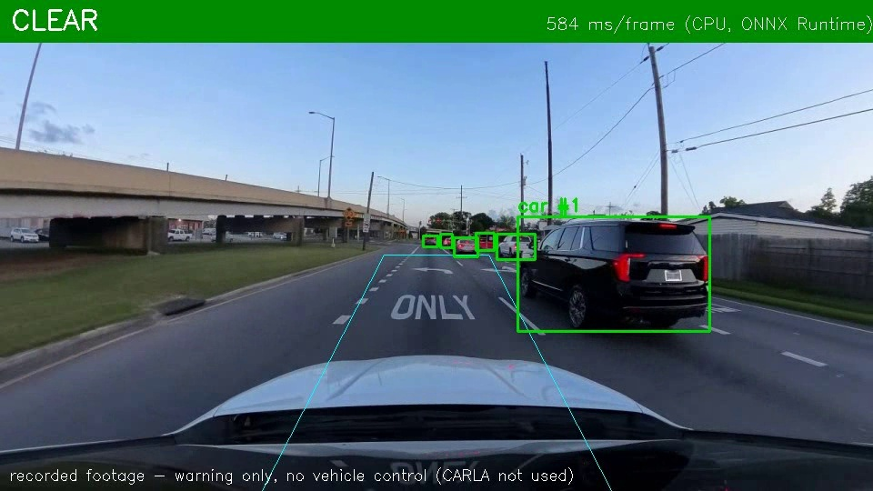
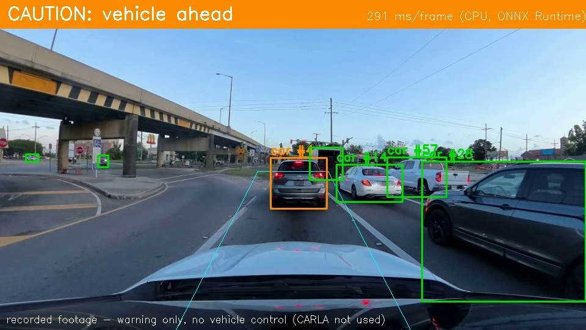

Detector:

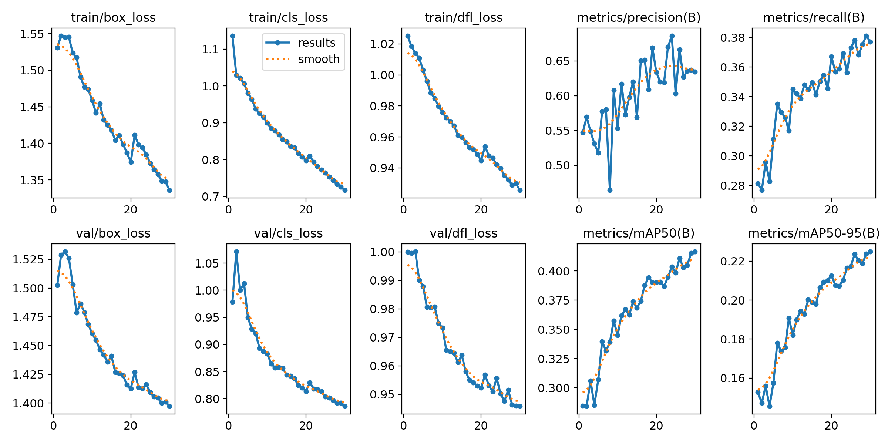
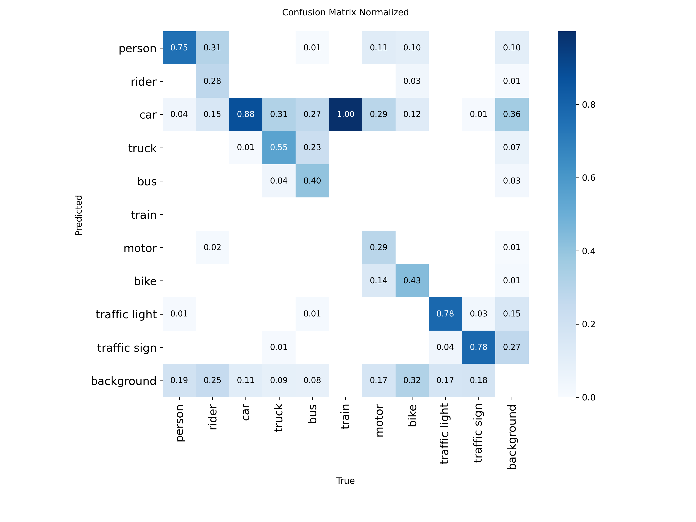
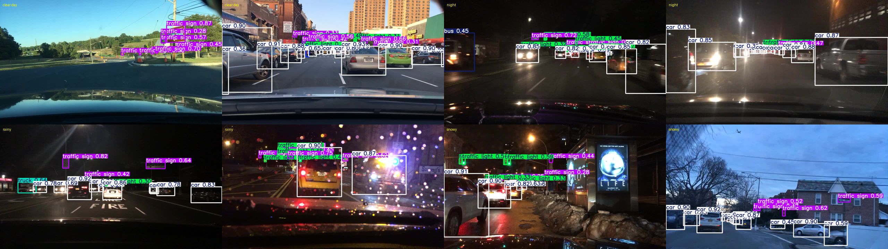
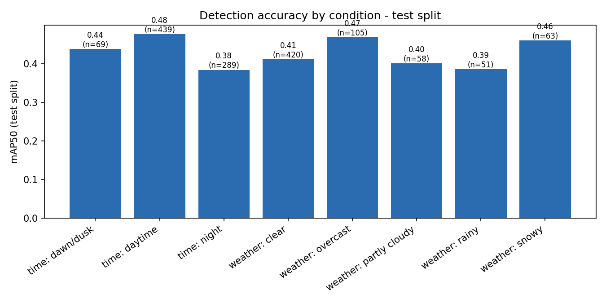

Data:

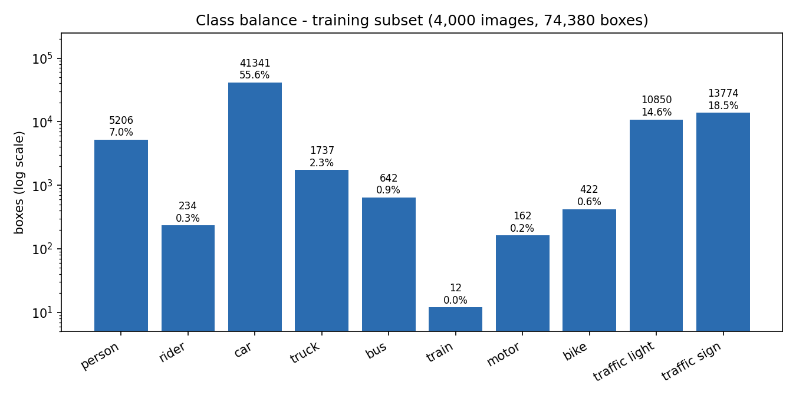
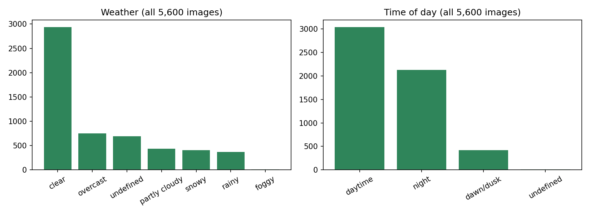

Lanes, depth and speed:

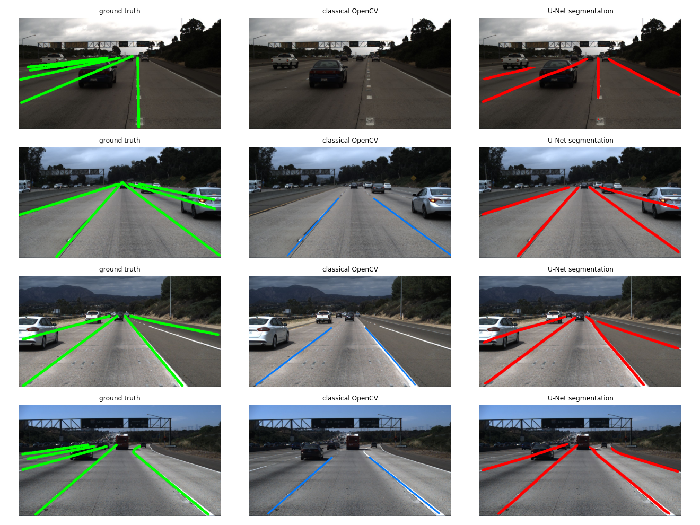
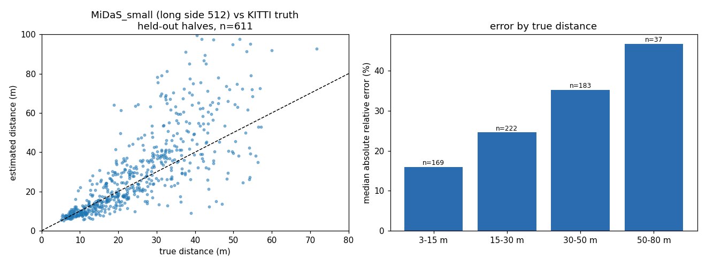
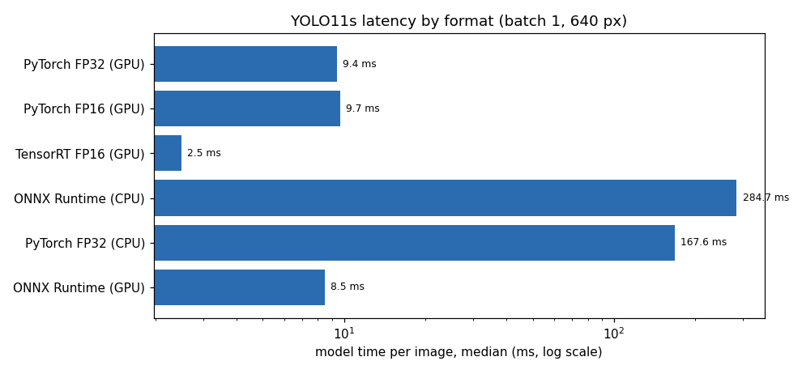
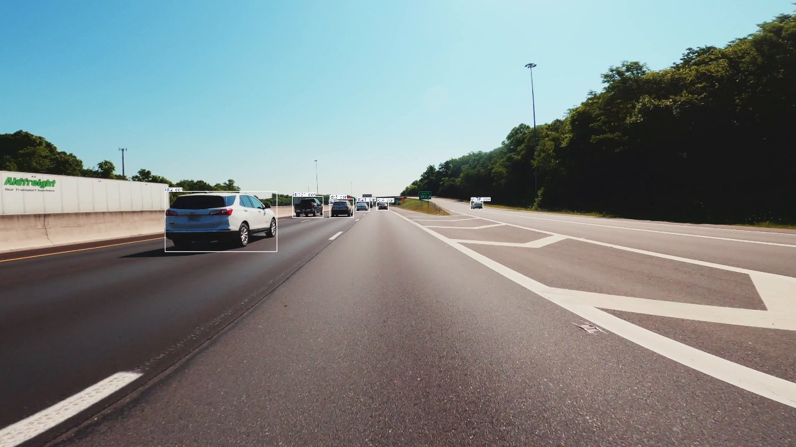
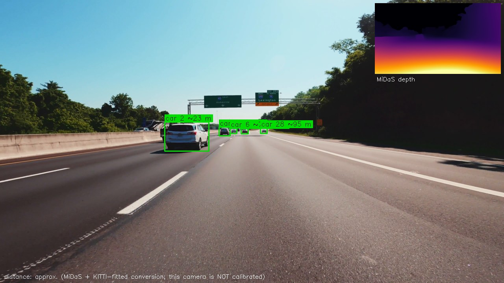

## Credits and licences

- BDD100K: Yu et al., CVPR 2020. Used through an unofficial Hugging Face copy (dronefreak/BDD100K, 2018 box labels) under the BDD100K data licence for research and educational use.
- TuSimple lane data through a preprocessed Kaggle copy (uploader lists apache-2.0, original terms not verified).
- KITTI through two Kaggle copies (uploaders list MIT and unknown, KITTI's own terms not verified). Only numbers and plots are included here, no dataset images.
- MiDaS (Ranftl et al.) through torch.hub. YOLO11 through Ultralytics. ByteTrack through Ultralytics. ONNX Runtime, TensorRT, ROS2 Humble, OpenCV, segmentation_models_pytorch and Weights & Biases.
- Dashcam clips: stock footage from Pexels (Pexels License). Individual videographers were not recorded. The raw clips are not in this repository.
- Built by Darshan Kumar GP. An AI assistant (Claude) was used as a tutor and pair-programmer.

## Related

Project 1 of this internship: https://github.com/DarshanKumarGP/ai-medical-imaging

