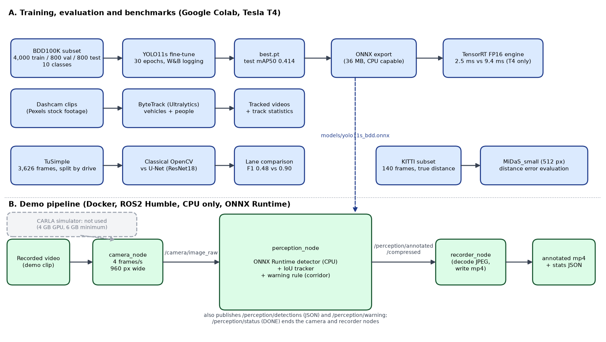

# Architecture

## Overview
The project is a vision pipeline for driving footage. Models are trained, evaluated and benchmarked in Google Colab (Tesla T4). A reduced version of the pipeline then runs in Docker on a laptop CPU as three ROS2 Humble nodes that process recorded video. CARLA was not used (see Limits).

## Components
| Component | Where | What it does |
|---|---|---|
| Data preparation | notebooks/01_data_prep.ipynb | Builds a BDD100K subset (4,000 train / 800 val / 800 test images), converts labels to YOLO format |
| Detector training | notebooks/02_train_yolo.ipynb | Fine-tunes YOLO11s, logs to Weights & Biases (project adp-bdd100k) |
| Tracking | notebooks/03_tracking.ipynb | ByteTrack through Ultralytics on dashcam clips |
| Lane detection | src/lane_classical.py, notebooks/04_lane_seg.ipynb | Classical OpenCV detector and a U-Net (ResNet18), compared on TuSimple |
| Depth and distance | notebooks/05_depth.ipynb | MiDaS_small depth, distance evaluated on 140 KITTI frames |
| Export and benchmark | notebooks/07_export_benchmark.ipynb | ONNX and TensorRT FP16 export, latency, FPS and mAP per format |
| ROS2 demo | ros2/, src/onnx_yolo.py, src/iou_tracker.py, src/warning_logic.py | camera_node, perception_node and recorder_node in one container |
| Tests | tests/ | 24 pytest tests (tracker, warning rule, detector decoding, lane detector) |

## ROS2 data flow
| Topic | Type | Content |
|---|---|---|
| /camera/image_raw | sensor_msgs/Image (bgr8) | Frames from the recorded clip, 4 per second, 960 px wide |
| /perception/annotated/compressed | sensor_msgs/CompressedImage (jpeg) | Frame with boxes, track ids, corridor and warning banner |
| /perception/detections | std_msgs/String (JSON) | Frame number, warning level, tracks with class and box |
| /perception/warning | std_msgs/String | CLEAR, CAUTION or BRAKE text |
| /perception/status | std_msgs/String | DONE once the last frame was processed |

The warning rule looks at tracked road users whose bottom-centre point lies in a trapezoid in front of the camera. The lower the bottom edge sits in the image, the closer it is assumed to be (CAUTION from 55 percent and BRAKE from 68 percent of the image height). These thresholds are uncalibrated guesses. Nothing steers or brakes a vehicle.

## Data sources
| Data | Source | Use | Licence note |
|---|---|---|---|
| BDD100K (2018 box labels) | Hugging Face copy dronefreak/BDD100K, mirrored from a Kaggle upload | Detector training and test | BDD100K data licence (research use). Unofficial redistribution |
| TuSimple (preprocessed) | Kaggle rangalamahesh/preprocessed-1 | Lane model and comparison | Uploader lists apache-2.0, original terms not verified |
| KITTI object detection | Kaggle ibrahimalobaid/kitte-dataset (images) and eeemmm1234/kitti-3d-train-calib-label-velodyne (labels) | Distance evaluation | Uploaders list MIT and unknown, KITTI's own terms not verified |
| Dashcam clips | Pexels stock footage | Tracking, depth and ROS2 demos | Pexels licence, videographers not recorded. Raw clips are not in this repository |

No dataset images are stored in the repository, only plots, split lists and numbers.

## Design decisions
- Training and benchmarking run on Colab because the laptop has a 4 GB GPU. The TensorRT engine was built on a T4 and only works on a T4.
- The container uses ONNX Runtime on the CPU and no PyTorch, because Docker is capped at 4 GB of memory. For that reason it uses a simple IoU tracker. ByteTrack results come from the notebooks.
- Annotated frames are sent as JPEG. Sending raw 960x540 images cost about 135 ms per frame and caused 18 of 80 frames to be dropped. JPEG reduced that step to about 15 ms and dropped frames to zero.
- Models and data are mounted into the container, not baked into the image. The image has a health check and a 3 GB memory limit.
- Container dependencies are pinned in ros2/requirements.txt. The laptop environment is pinned in requirements.txt (numpy 2.x there, numpy 1.26.4 in the container).

## Measured performance
Detector on the 800-image test split (YOLO11s, 640 px, batch 1, Tesla T4, 200 images timed):
| Format | Model time | Total per image | FPS | Test mAP50 |
|---|---|---|---|---|
| PyTorch FP32 | 9.42 ms | 13.34 ms | 74.9 | 0.4136 |
| PyTorch FP16 | 9.70 ms | 13.49 ms | 74.1 | 0.4135 |
| ONNX Runtime (GPU) | 8.47 ms | 11.34 ms | 88.2 | not measured |
| TensorRT FP16 | 2.50 ms | 5.52 ms | 181.0 | 0.4114 |

On Colab's 2-core CPU (40 images): PyTorch FP32 167.6 ms, ONNX Runtime 284.7 ms (mAP50 0.4124).

ROS2 demo on the laptop CPU, in Docker, 4 frames per second input (about 20 s clips):
| Run | Frames sent / processed / dropped | Callback median | Callback p95 |
|---|---|---|---|
| clip2, raw image topic (run 1) | 80 / 61 / 19 | 634.5 ms | not recorded |
| clip2, raw image topic (run 2) | 80 / 62 / 18 | 308.6 ms | not recorded |
| clip2, JPEG topic | 80 / 80 / 0 | 222.7 ms | 349.9 ms |
| clip6, JPEG topic, first run | 86 / 86 / 0 | 242.0 ms | 332.9 ms |
| clip6, JPEG topic, final run | 86 / 86 / 0 | 393.5 ms | 633.5 ms |
| clip6, fresh clone of the repository | 86 / 86 / 0 | 431.9 ms | 679.3 ms |

The callback time varied between runs of the same code, and I do not know the cause. When it exceeds 250 ms the camera waits for the detector, so nothing is dropped but the demo plays slower than real time. On clip6 the warning showed CAUTION in 64 of 86 frames (first at frame 9, sustained from frame 24) and never reached BRAKE.

## Limits
- CARLA was not run. The laptop GPU has 4 GB and CARLA asks for at least 6 GB. The ROS2 demo therefore streams recorded video.
- The tracker in the container is an IoU matcher. Tracking quality was judged by eye, since the clips have no ground-truth identities, so there is no ID-switch score.
- Distances are approximate. A conversion fitted on KITTI frames was applied to clips from unknown cameras.
- Lane results come from one highway dataset (TuSimple), and its test frames come from a single drive.
- The detector was trained on a 4,000-image subset for 30 epochs. Scores are lower than full-dataset results.
- The rare classes (train, motor, rider) have too few test boxes for reliable numbers. The train class has a single test box.

## Reproducibility
- Python packages are pinned (requirements.txt, requirements-dev.txt, ros2/requirements.txt).
- Models are versioned with DVC (models.dvc). The DVC store is local to the author's laptop, so the model files are also provided in the Drive submission folder.
- A fresh clone was tested: the environment was rebuilt, 24 tests passed, the Docker image was rebuilt without cache and the demo reproduced the same warning counts (docs/fresh_clone_stats.json).
